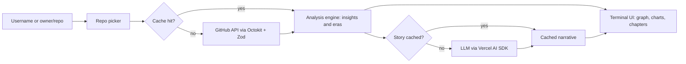

# commit story_

**Your code has a story. Read it.**

Commit Story turns any public GitHub user's repository history into a terminal-style visual timeline and an AI-written narrative. Enter a username, pick a repo, and read its history as chapters: commits, contributors, eras, and the people behind the code.

**Live demo:** https://commit-story-mu.vercel.app/


---

## Features

**Explore**
- **Username or repo input**: enter `username` or `owner/repo` (full GitHub URLs and `git@github.com` addresses also work). A username opens a repo picker; `owner/repo` goes straight to the story.
- **Terminal-style repo picker**: an `ls -la`-style listing with live filtering, a toggle to hide forks and archived repos, and keyboard navigation.

**Understand**
- **Repository insights**: commits per week, busiest day and hour, contributor leaderboard, longest commit streak, biggest commits, and automatically detected "eras" of the project.
- **Visual timeline**: ASCII git graph, block-character bars, a contribution heatmap and an activity chart, all in one consistent terminal theme.
- **AI-written story**: a streamed narrative, one chapter per era, grounded only in the repository's real data.
- **Handles thin data gracefully**: repos with one commit or one contributor show honest, compact output instead of empty sections.

**Share**
- **Dynamic Open Graph images**: every story link gets a terminal-style preview card with the repo's real stats.
- **Share bar**: copy the link, export the story as Markdown, or copy a README badge snippet.
- **Embeddable SVG badge**: show your repo's commit count in any README.

**Built to be reliable**
- **Redis caching** (Upstash): GitHub data, generated stories and repo lists are cached and keyed by the latest commit SHA, so a new commit refreshes the story automatically.
- **Distributed rate limiting**: per-IP limits on story generation protect the LLM key, with clear terminal-style error messages.
- **Terminal-styled error states**: not found, private repo, empty repo, rate limited and GitHub API down each have their own page.
- **Keyboard-first and accessible**: auto-focused prompt, `/` to focus input, `j`/`k` to move around, `?` for shortcuts, visible focus states, and support for `prefers-reduced-motion`.
- **Responsive**: works from phone to desktop.

## How it works



1. The input is parsed and validated (`src/lib/repo.ts`).
2. Repository data (metadata, commits, merged PRs, contributors, languages) is fetched with pagination and rate-limit handling, and cached in Redis (`src/lib/github.ts`, `src/lib/cache.ts`).
3. Pure, unit-tested functions turn raw data into a typed `RepoInsights` object (`src/lib/analyze.ts`).
4. The UI renders the insights as a terminal-themed timeline.
5. A compact summary of the insights and the most significant commit messages is sent to an LLM, which streams back the story. The finished story is cached, so repeat visits are instant and cost nothing.

### Caching and rate limits

| What | Cache time | Key |
|---|---|---|
| GitHub repo data | 6 hours | `owner/repo` + latest commit SHA |
| AI narrative | 24 hours | `owner/repo` + latest commit SHA |
| User repo list | 15 minutes | `username` |

- Story generation is limited per IP address with a sliding window plus a daily cap.
- A manual refresh bypasses the cache but is itself limited to one refresh per repo every 5 minutes per IP.
- If Redis is not configured (for example in local development), the app falls back to no caching and an in-memory limiter.

## Tech stack

| Area | Tools |
|---|---|
| Framework | Next.js (App Router), React, TypeScript |
| Styling | Tailwind CSS, custom terminal design system |
| Data | Octokit (GitHub REST API), Zod |
| Charts | Recharts, custom ASCII components |
| AI | Vercel AI SDK, Google Gemini |
| Caching and limits | Upstash Redis, @upstash/ratelimit |
| Images | next/og (dynamic Open Graph images) |
| Testing | Vitest |
| Deployment | Vercel |

## Getting started

### Prerequisites

- Node.js 20 or newer
- A [GitHub personal access token](https://github.com/settings/tokens) (no scopes needed for public repos)
- An LLM API key (Google AI Studio offers a free tier)
- Optional: a free [Upstash Redis](https://upstash.com) database for caching and rate limiting

### Setup

```bash
git clone https://github.com/ashisharma06/commit-story.git
cd commit-story
npm install
cp .env.example .env.local
```

Fill in `.env.local`:

```
GITHUB_TOKEN=
GOOGLE_GENERATIVE_AI_API_KEY=
AI_MODEL=
UPSTASH_REDIS_REST_URL=
UPSTASH_REDIS_REST_TOKEN=
NEXT_PUBLIC_SITE_URL=http://localhost:3000
```

| Variable | Purpose |
|---|---|
| `GITHUB_TOKEN` | Raises the GitHub API limit from 60 to 5,000 requests per hour |
| `GOOGLE_GENERATIVE_AI_API_KEY` | API key for the LLM that writes the story |
| `AI_MODEL` | Model name to use, so it can be swapped without code changes |
| `UPSTASH_REDIS_REST_URL` / `UPSTASH_REDIS_REST_TOKEN` | Redis connection for caching and rate limiting (optional locally) |
| `NEXT_PUBLIC_SITE_URL` | Public base URL, used for Open Graph images and badge links |

Then start the dev server:

```bash
npm run dev
```

Open [http://localhost:3000](http://localhost:3000).

### Scripts

| Command | What it does |
|---|---|
| `npm run dev` | Start the development server |
| `npm run build` | Create a production build |
| `npm run lint` | Run ESLint |
| `npm run typecheck` | Run the TypeScript compiler without emitting files |
| `npm run test` | Run unit tests with Vitest |

## Using the badge

Add your repo's Commit Story badge to any README:

```markdown
[](https://your-app.vercel.app/story/OWNER/REPO)
```

Replace `OWNER/REPO` with your repository. The story page also has a `$ badge` button that copies this snippet for you.

## Project structure

```
src/
  app/
    page.tsx                   Landing page with the prompt
    u/[username]/              Repository picker
    story/[owner]/[repo]/      Story page and Open Graph image
    badge/[owner]/[repo]/      SVG badge route
    api/story/                 Streaming narrative route handler
  components/                  Terminal UI: prompt, graph, bars, heatmap, chapters
  lib/
    repo.ts                    Input parsing and validation
    github.ts                  GitHub API client
    analyze.ts                 Insights and era detection
    llm.ts                     Prompt building for the narrative
    cache.ts                   Redis caching helpers and key builders
```

## Design

The whole app is styled as a terminal: a dark theme, a single monospace font, a green accent, ASCII graph and bar components, a boot-sequence loading state, and a typewriter effect for the AI story. Open Graph images and the badge use the same theme so shared links look like the app.

## Known limitations

- Only **public** repositories are supported.
- History is capped at the most recent 1,000 commits per repository for speed and API limits.
- The AI narrative is grounded in commit messages and statistics, so repos with vague commit messages produce vaguer stories.
- Story generation depends on the free-tier limits of the LLM provider.

## Possible next steps

- GitHub OAuth for private repositories
- Compare two repositories side by side
- Public gallery of popular stories
- Export the story as a PDF

## License

MIT

## Author

Built by [Ashish Sharma](https://github.com/ashisharma06).
